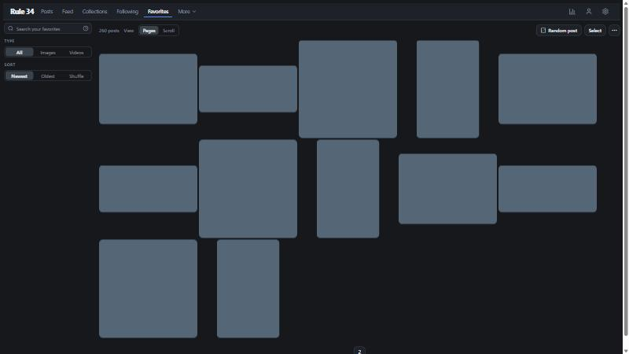
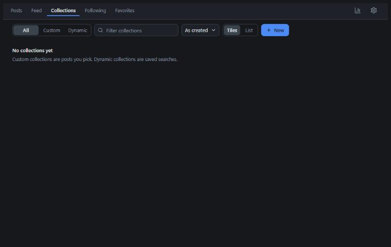
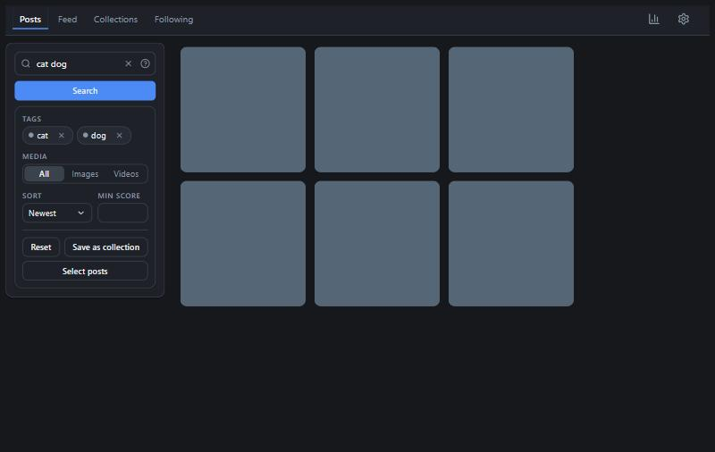
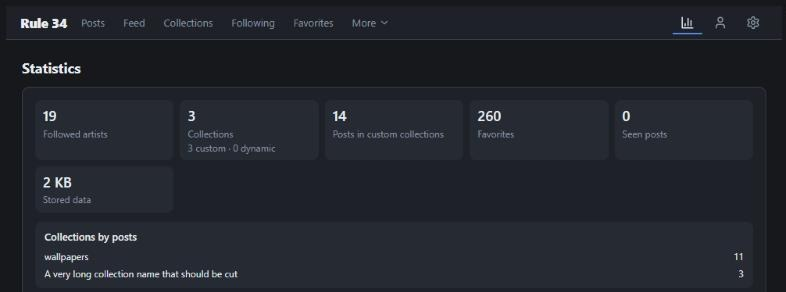
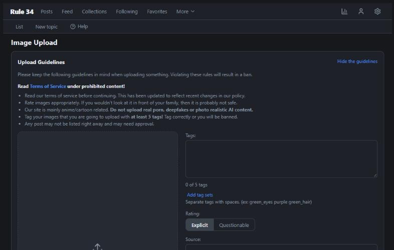
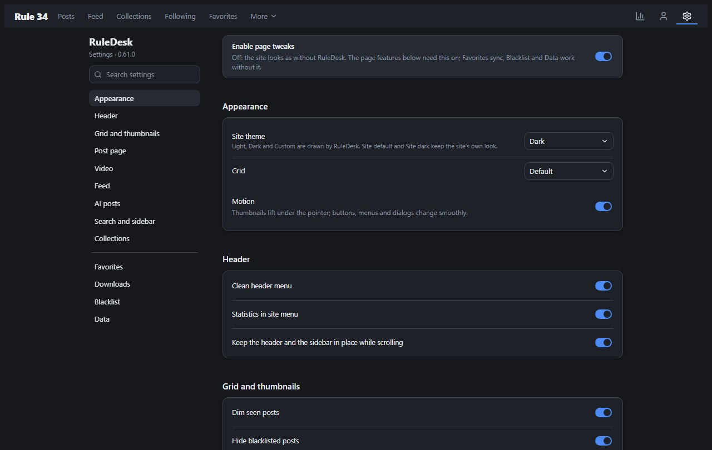

# RuleDesk

A userscript for `rule34.xxx`. It adds a feed of the artists you follow, collections, search inside your favorites, a reworked search panel and post page, a download manager, statistics and themes, and it tidies the site's own pages. It runs in your browser on the site's pages, keeps all its data on your computer and has no server.

*Screenshots here are taken on a local test page with grey boxes in place of pictures.*

- [What it adds](#what-it-adds)
- [Install](#install)
- [Settings](#settings)
- [Themes](#themes)
- [Your data](#your-data)
- [What the script does not do](#what-the-script-does-not-do)
- [Every feature in detail](docs/features.md)
- [FAQ](FAQ.md)
- [Changelog](CHANGELOG.md)
- [Developer documentation](docs/)

## What it adds

A short tour. Each item is described in full, with what it asks the site for and how to switch it off, in [docs/features.md](docs/features.md).

### A menu that fits in one row

The site's long menu becomes three zones: **Posts, Feed, Collections, Following, Favorites** on the left, the site's other sections under **More**, and **Statistics**, **My Account** and **RuleDesk** (settings) as icons on the right. The header and the sidebar stay in place while you scroll. A number beside Feed says how many new posts are waiting.

### Feed and Following

**Follow** an artist, a character or a copyright with the button next to its tag. **Feed** is one grid with the posts of everyone you follow, newest first, with NEW marks and "Mark all seen". **Following** lists them as cards with a cover, a post count and a "new" mark; filter, sort, group, unfollow several at once.

### Collections

- **Custom**: posts you pick, with the "+" on a thumbnail or a post, or several at once with "Select posts". Reordered by dragging. A post opened from one gets previous / next arrows through the collection
- **Dynamic**: a saved search. "Save as collection" in the search panel; "Check for new" tells which of them got new posts

### A search panel instead of typing syntax

Under the site's search field: the tags of the query as chips (click to exclude, cross to remove), Images / Videos, sort order, minimum score, AI posts on or off, Reset, "Save as collection", "Select posts".

### Search inside your favorites

The site cannot search favorites. After one **Sync favorites**, the Favorites page gets a row that stays at the top: search by tags (`tag`, `-tag`, `ta*g`, `( a ~ b )`), Images / Videos, endless scroll, Shuffle, Random post, and Select to remove several or add them to a collection.

### The post page

Favorite, Collections, Vote, "I came", Original and Download as buttons; details and comments in two tabs; the site's own actions in one list. A click on a picture opens a zoom viewer. GIFs play on the page. The video player keeps volume and speed, toggles on a click and can fit the height or the width.

### The grid

A favorite star and "+" on thumbnails, three sizes, infinite scroll, dimming of posts you opened, hiding of blacklisted posts, optional video preview on hover, a "GIF" label, folding tag groups in the sidebar, the wiki text of a tag on its "?".

### Download manager

Saves the original files of a custom collection, a whole search, picked posts or all your favorites into a folder in your browser's downloads, with a name you choose (`rule34-<id>` by default). A corner panel shows progress, Pause, Resume, Cancel. It needs your own API key from the site's account options page; a single post's Download button does not.

### Statistics

Counts of what you keep, how they change day by day, the top tags of your favorites, and your site profile numbers on request.

### The site's other pages

Forum: marks for new and updated topics, "New for me", "Mark all as read". Artists and Tags: Follow and "Save as collection" in each row. Upload: a drop zone with a preview, a tag count against the site's minimum, repeated tags dropped.

## Install

1. Install [Tampermonkey](https://www.tampermonkey.net/) (recommended) or [Violentmonkey](https://violentmonkey.github.io/).
2. Open this link and confirm the installation:
   https://raw.githubusercontent.com/KazeKaze93/RuleDesk/main/dist/ruledesk-web.user.js
3. In Tampermonkey open Dashboard → Settings → Security → Content Script API and choose **UserScripts API Dynamic**. Without it the site's original look flashes on every page load and pages open slower.

Updates arrive through the script manager from the same link. After an update reload the site's page: an open page keeps running the old version.

## Settings

Header menu → the gear (**RuleDesk**). Every block folds with a click on its title.

| Block | What is there |
|---|---|
| Appearance | Theme and grid size; for the Custom theme a background picture |
| Page | A switch for each page feature, and one switch, "Enable page tweaks", that turns all of them off |
| Blacklist | The site's tag blacklist for this browser |
| Favorites | Favorite buttons in the grid; Sync favorites and Full resync |
| Downloads | Your API key and the file name of saved files |
| Data | Export and import of everything the script stores; when the last backup was made |

To get the untouched site back: Appearance → Site theme → **Site default**, and Page → turn off **Enable page tweaks**.

## Themes

| Theme | What it is |
|---|---|
| **Light**, **Dark** | The script's own themes. The whole site is restyled. This is where the script looks the way it was designed |
| **Custom** | Light or Dark with your background picture |
| **Site default**, **Site dark** | The site's own look. The script restyles nothing of the site there; its additions are drawn in the site's colours and can look out of place beside the site's plain controls. Light, Dark or Custom is recommended |

## Your data

- Collections, followed tags, marks and settings live in the script manager's storage, in this browser only. Nothing is sent anywhere
- **Data → Export** saves one JSON file; **Import** restores it (Merge adds to what you have, Replace overwrites). This is the only way to move to another browser
- The blacklist and the site theme are the site's own cookies and are not in the export. Neither is the API key
- The one request made without an action of yours is the counter beside Feed: the first page of the feed, at most once in 15 minutes. It has its own switch in RuleDesk → Page
- Otherwise the script reads the pages you open and makes a request only when you do something that needs one: favorite a post, sync favorites, start a download, type in a tag field, scroll for the next page, open a feed that spans several searches, press Refresh, Check for new or Refresh profile, click the "?" of a tag. Requests go one at a time with a pause

## What the script does not do

These come from the site, or from what a userscript is, and are not bugs.

- **No background updates.** Covers, counts and "new" marks change when you open a page or press Refresh / Check for new. The site refuses frequent requests
- **No sync between browsers or devices.** There is no server; use Export and Import
- **It cannot show what the site does not give.** No post dates in the grid, no avatars, no exact count for a search of several tags (shown as "12,516+")
- **It does not touch your account.** Login cookies are not read, account settings are not changed
- **Files can only be saved into the browser's download folder**
- **"Too many requests".** Refresh, Check for new and favorites sync stop at the first such answer from the site; wait a minute and start again
- **A cover or a count** for a followed tag or a collection appears after its page was opened once, or after Refresh
- **When the site changes its pages**, a feature on the changed page can stop working until the script is updated. The site itself keeps working

The full list is in [docs/features.md](docs/features.md#what-the-script-will-not-do); the technical one, with numbers, in [docs/site.md](docs/site.md#limits-that-come-from-the-site).
