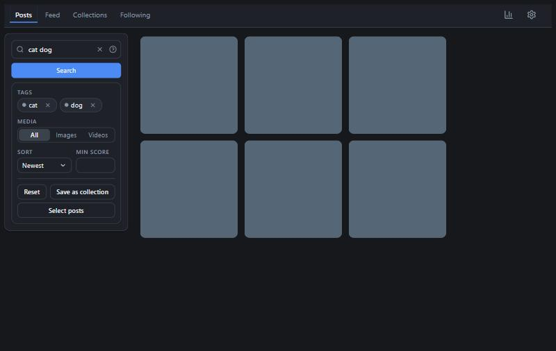
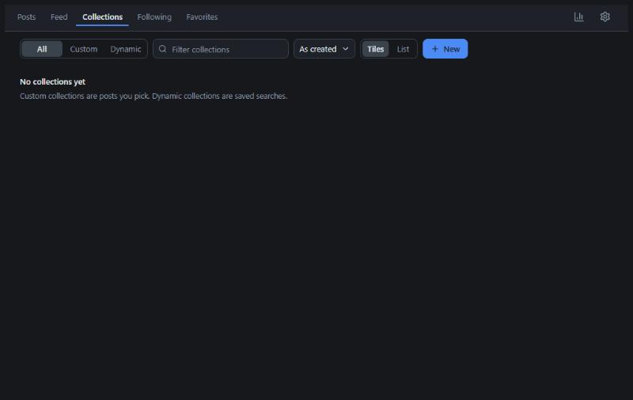
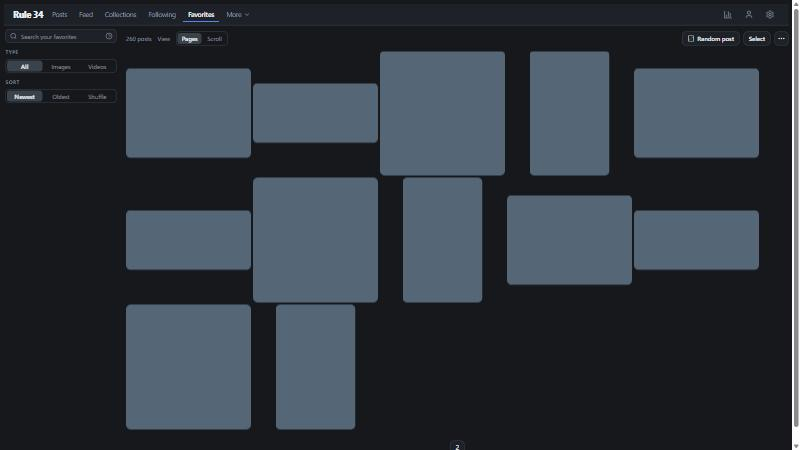
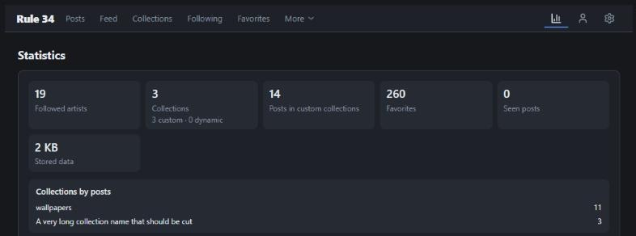
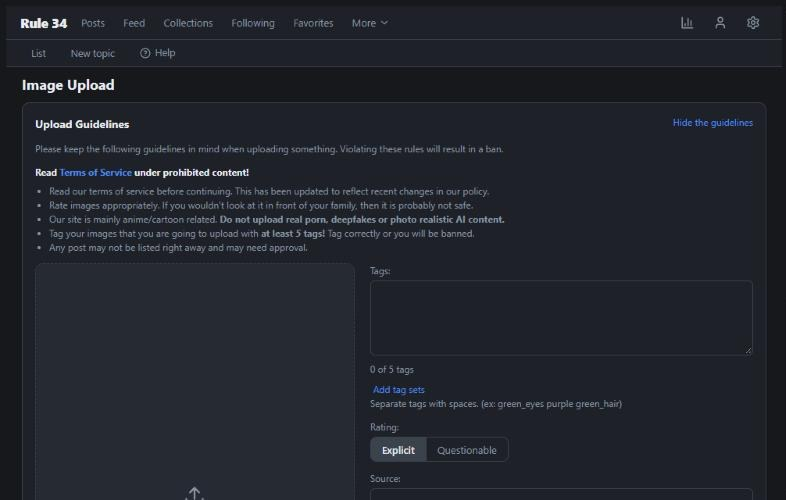
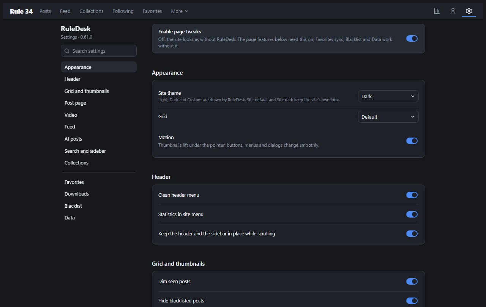

# Features

Everything RuleDesk does, screen by screen: what a feature is for, where it shows, how it is switched off, and what it asks the site for. Written for a user who wants to know what a switch does, and for a designer or a developer who needs the whole picture before changing anything.

- [How the script sits on the site](#how-the-script-sits-on-the-site)
- [The header](#the-header)
- [Posts: the results page](#posts-the-results-page)
- [Selecting](#selecting)
- [The post page](#the-post-page)
- [Feed](#feed)
- [Following](#following)
- [Collections](#collections)
- [Favorites](#favorites)
- [Download manager](#download-manager)
- [Statistics](#statistics)
- [The site's other pages](#the-sites-other-pages)
- [Themes](#themes)
- [Settings](#settings)
- [What the script will not do](#what-the-script-will-not-do)

The screenshots are taken on a local test page with grey boxes in place of pictures. The layout is the script's; the pictures and the site's own styles are not there.

## How the script sits on the site

RuleDesk is a userscript: a file the browser extension Tampermonkey runs on every page of `rule34.xxx`. It has no server and no account. It changes the pages in the browser, after the site has sent them.

There are three kinds of screen, and they behave differently:

| Kind | Examples | What the script can do there |
|---|---|---|
| A site page with additions | Posts, a post, Favorites, Forum, Upload, Tags, Artists | Recolour it, move blocks with CSS, add its own controls. The markup is the site's and stays; what the site does not put on the page cannot be shown |
| A page of the script's own | Collections, a custom collection, Following, Statistics, RuleDesk (settings) | Anything: these are drawn by the script from its own data. They open at once, with no request to the site |
| A site page the script leaves alone | Most of My Account, Help, wiki editing, pools | Only the theme's colours |

Two rules shape nearly every decision:

1. **Data comes from pages the user opens.** The script reads the page in front of it (a cover, a post count, a tag list) and remembers it. It does not go and fetch things in the background. That is why a card can say "not opened yet".
2. **A request is made only for a user's action**, one at a time, with a pause. The site answers "too many requests" (HTTP 429) quickly. The exceptions are listed in [What the script will not do](#what-the-script-will-not-do).

## The header

The site's menu is a long single list. With **Clean header menu** on it becomes three zones in one row with the site's title:

- left: Posts, Feed, Collections, Following, Favorites — what is used most
- **More**: the site's other sections (Comments, Wiki, Aliases, Artists, Tags, Pools, Forum, Help and the rest) in a drop-down
- right, as icons: Statistics, My Account, RuleDesk (the gear)

The current section is underlined. A dot on the gear means a backup is due (see [Statistics](#statistics)). The second row, the site's sub-menu of the current section, keeps its links and gets icons.

**Keep the header and the sidebar in place while scrolling** (on by default) makes the header stay at the top of the window, and the sidebar of Posts and of a post stay beside the content, scrolling inside itself when it is taller than the window.

**New posts counter beside Feed** is the number in a pill next to Feed: how many posts on the first page of the feed are newer than the newest one already seen there. "42+" means the whole first page is new.

## Posts: the results page

### Search panel — "Search tools"

The site has one text field for a search, and everything is typed as text: tags, `-tag`, `sort:score:desc`, `score:>=50`. The panel under the field turns the common parts into controls and writes the text for the user:

| Control | What it writes into the search |
|---|---|
| Tags as chips | Each tag of the query is a chip, coloured by its type when the type is known. A click excludes the tag (`-tag`), the cross removes it |
| Media: All / Images / Videos | Adds or removes `video` and `-video` |
| Sort: Newest, Oldest, Top score, Recently updated, Random | `sort:id:asc`, `sort:score:desc`, `sort:updated:desc`, `sort:random` |
| Min score | `score:>=N` |
| AI posts: Show / Hide | The choice of the part of the site this list is of (Posts, Feed, Following, Collections): kept by the script, applied through the site's own "Filter AI posts" cookie, and the list is loaded again |
| Reset | Clears the query |
| Save as collection | Saves the query as a dynamic collection |
| Select posts | Turns on picking posts in the grid, then "Add to collection (N)" and, with an API key, "Download selected (N)" |
| Download results | With an API key: saves the files of the whole search |

The site's field itself gets a magnifier, a button that clears it and a "?" that lists the search syntax (in the script's own themes only).

### Tag list in the sidebar — "Collapse tags"

The sidebar lists the tags of the posts on the page by type: Copyright, Character, Artist, General, Meta. With the feature on, each type is a group that folds; General and Meta start folded because they are long. Next to an artist, character or copyright tag there is a **Follow** button.

**Tag description on the ? in the sidebar** ("Tag description on “?”" in the settings): the "?" beside a tag normally leaves the page for the wiki. With the feature on, a click shows the wiki text of the tag in a small panel next to it. It costs two requests per click (the wiki search, then the entry) and is kept until the page is left.

### The grid

| Feature | What it does |
|---|---|
| Grid size (Appearance → Grid) | Default, Compact or Large thumbnails |
| Show favorite buttons in grid (Favorites block) | A star on each thumbnail: one click adds the post to favorites on the site |
| Add to collection button | A "+" on each thumbnail and on the post page: opens the list of custom collections |
| Infinite scroll | The next page is appended when the end of the grid is reached. It pauses after two pages in a row that add nothing and shows "Load more" |
| Dim seen posts | A post that was opened is dimmed in the grid |
| Hide blacklisted posts | Posts with a tag from the blacklist are removed from the grid instead of being shown as a placeholder |
| Hide tag tooltip on thumbnails | The browser tooltip with the full tag list does not pop up over a thumbnail |
| Video preview on hover (off by default) | Pointing at a video thumbnail plays the video in its place. It loads the video file itself |
| A "GIF" label | Animated GIFs are marked on the thumbnail |
| Play icon on video thumbnails | A video has a play sign in the same kind of plate, in place of the frame around the thumbnail. Off: the frame. In the site's own themes the site's frame stays |
| Motion | Thumbnails lift a little under the pointer; buttons, menus and dialogs change smoothly. Off for those who want none of it |
| Sidebar on the right | Moves the sidebar of Posts and of a post to the right side |

### Dynamic collection bar — "Collection header"

When a saved search is opened from the Collections page, a bar above the grid names the collection and has Shuffle, Edit query, Rename and Delete. The same search typed by hand is an ordinary search and has no bar.

## Selecting

Wherever posts or cards can be selected, the bar is the same: how many are selected, "Select all" or "Select page", "Clear", the actions, the dangerous action after a rule, "Cancel". On Following, Collections and the page of a collection it stands in the place of the toolbar. On Posts and Favorites it is a card at the top of the column, with the filters under it dimmed and locked. Escape cancels; Ctrl+A selects all. A name that ends in dots asks before it acts.

## The post page

**Post side panel** replaces the site's scattered links with one panel beside the picture. On a wide window the picture, in the size the site gives it, and the panel stand together in the middle of the page. The key F presses Favorite:

- buttons: Favorite, Collections ("+"), Vote, "I came", Original (opens the full file), Download (saves the file; needs no key)
- two tabs: **Info** (id, date, uploader, size, source, rating) and **Comments**
- the site's own actions in one list: Edit, Resize image, Report to moderation, Add note
- when the post was opened from a custom collection: a strip with previous / next that walks the collection, and a button back to it

| Feature | What it does |
|---|---|
| Zoom the picture on click | A click on the picture opens a viewer over the page: scroll to zoom, drag to move, Esc to close. Pictures and GIFs |
| Play GIFs on the post page | The site shows a still JPEG sample of a GIF and the moving file only behind "Original image". The script puts the GIF in place of the still |
| Load full-size image | Off unless turned on. The file behind "Original image" is loaded and shown in place of the scaled-down copy: sharper and as wide as the room allows, but an original is often several MB |
| Video player tweaks | The player remembers volume and speed between posts; a click on the video plays and pauses; "Video size" fits the height, fits the width or keeps the original size |
| Retry a failed post image on other servers | If the picture fails to load, the same path is tried on the site's other image servers |

## AI posts, by the part of the site

The site has one switch for AI posts, for every list at once. The script keeps a choice for each part and moves the site's switch to it:

| Part | What belongs to it | Where the choice is |
|---|---|---|
| Posts | any search that is none of the below | "AI posts" in the sidebar |
| Feed | the search of everyone followed | "AI posts in Feed" in the sidebar |
| Following | the Following page, and the list of one followed tag | the toolbar of Following; "AI posts in Following" in the sidebar |
| Collections | the Collections page, and a saved search | the toolbar of Collections; "AI posts in Collections" in the sidebar |
| Favorites | the favorites page | "AI posts" in the card of filters |

On the lists the server leaves AI posts out, so pages stay full. Favorites is not filtered by the site: the script leaves out the posts tagged `ai_generated`, which needs a synced index. A collection of posts shows what was put into it, whatever the choice.

"Hide AI posts everywhere" in the settings overrides every part: the controls then show Hide, cannot be changed, and link to the setting.

## Feed

The posts of everyone the user follows, newest first, as one grid. Technically it is an ordinary site search of the form `( artist1 ~ artist2 ~ … )`, opened from the menu item **Feed**.

- New posts carry a **NEW** mark. "Mark all seen" moves the mark to the newest post; "Only new" hides the rest
- One site search holds a limited number of alternatives. With more followed tags than one search can hold (400 by default; the number is a setting), the feed is assembled from several searches and merged by date. "Only new" is not offered on such a feed

## Following

The script's own page: everyone followed, as cards (tiles or a list).

- A card shows a cover of four thumbnails, the name, the post count, a NEW mark when there are posts newer than the feed's seen mark, and the kind when it is not an artist (character, copyright)
- **Follow** is pressed next to a tag in the sidebar, on the site's Artists and Tags pages, or through "Add artists" here, which takes one or several tags
- Toolbar: All / New, a filter by name, sort (name, post count, date followed), a filter by type, Tiles / List, Select (unfollow several at once, move several to a group), Refresh
- **Groups** are tabs under the toolbar: "All", each group with its count, "No group", and "New group" at the right end. The open tab is underlined; the arrows go from tab to tab. The groups stand in the order they were made. Those that do not fit the row are behind "More (N)"; the open one always has a tab. With more than ten groups the menus of groups have a field to find one in. A name may be 40 characters long and is cut on its tab after 20. A card is in one group or in none. It is moved with "Move to group" (the button in its corner, shown under the pointer beside the cross, or in the bar of a selection) or by dragging it onto a tab. A group is renamed or deleted from the button on its tab; deleting it puts its cards into "No group"
- **Refresh** re-reads the first page of every followed tag for a fresh cover and count: one request per tag, 1.5 seconds apart, after a confirmation. It stops at the first error
- A card that says "not opened yet" has never been seen by the script: open the tag's page once, or press Refresh

## Collections

Two kinds, one page:

| | Custom | Dynamic |
|---|---|---|
| What it is | Posts picked by hand | A saved search |
| How it is made | "+" on a thumbnail or on a post; "Select posts" → "Add to collection"; "New" on the page | "Save as collection" in the search panel; "Save as collection" on the site's Tags page; "New" on the page |
| Where it opens | On the script's own page, at once | On the site, as that search |
| Order | By hand: posts are dragged | The site's |
| Post count | Exact | Exact for a single tag; a lower bound with "+" for several |

- A card shows a cover, the name, the kind and the count. A dynamic one shows "saved search" until it has been opened once
- Toolbar: All / Custom / Dynamic, a filter by name, sort ("Newest first", "Oldest first", "Name", "Most posts"), Tiles / List, Select (delete several, move several to a group), **Check for new**, New
- **Groups**, as on Following and apart from its groups: tabs under the toolbar, "Move to group" on a card and in the bar of a selection, a card dragged onto a tab
- The cross in the corner of a card, shown under the pointer, deletes the collection after a confirmation
- **Check for new** asks the site for the first page of every dynamic collection, one at a time with a pause, and marks those that have posts newer than when they were last opened ("Dynamic · new"). It also refreshes covers and counts
- A custom collection can be shuffled, renamed, deleted, and, with an API key, downloaded as files

## Favorites

The site's Favorites page, with a column at the left that holds everything the script adds to it and stays in place while scrolling ("Bulk remove favorites" in settings). The grid itself is the site's and is not wrapped or moved. In the column:

- a search over the user's own favorites: `tag`, `-tag`, `ta*g`, `( a ~ b )`; the "?" lists the syntax
- suggestions under the field as a word is typed: tags the favorites have, with their counts, those that begin with the word first. Up, Down, Enter or Tab, Esc. While the list is open the page keeps the last result; the search is applied on a pick, on Enter, after a space, and when the field is left
- when nothing matches, a line that says so in place of the grid, with the nearest tag offered for a word that is no tag
- the terms of the search as chips: a click excludes a tag or includes it again, the cross takes it out; a group `( a ~ b )` is one chip
- Type: All / Images / Videos
- Sort: Newest (the site's order: the post made a favorite last comes first), Oldest (the same list turned over) or Shuffle; a click on Shuffle while it is chosen shuffles again

- the count of posts, in the heading of the column
- View: Pages (the site's paging) or Scroll (endless)
- **Collection**: "Any", "Not in any collection", or one of your collections of posts; the list is narrowed to the favorites that pass. Saved searches are not listed: they hold a query, not posts
- "Reset search", shown when there is a search, a type or a collection to reset; the order and the paging are left as they are
- under the card, **Followed tags**: the entries of your Following page found among the favorites, with the number of favorites each has; a click adds the tag to the search or takes it out. The dot is the kind (artist, character, copyright). Twelve are listed before "Show all"
- at the foot of the card, each a button of its own: **Random post**, **Select**, and, quieter, **Download all…** (with an API key; with a search, a Type or a Collection set it is **Download results…** and takes only what the list shows, on all its pages) and **Sync favorites…**, which opens the settings at the Favorites block
- a condition that does not work here (`rating:`, `user:`…) is named in a warning plate under the field for as long as it stands there

Select puts a selection bar at the top of the column: pick posts, then remove them from favorites or add them to a collection. While posts are being selected the filters under the bar are shown but locked.

The site has no search inside favorites. The script can offer one only because it keeps a local list: **Sync favorites** (settings → Favorites) walks the user's favorites pages once and stores ids and tags; "Full resync" rebuilds the list. Search, the type switch, Scroll and Shuffle appear after a full resync. The local list holds tags and ids only, so the site's other metatags (`rating:`, `score:`, `user:`) do not work here; they do on Posts.

## Download manager

Saves original files in bulk: a custom collection (all of it or selected posts), a whole search, posts picked on a results page, or all favorites.

- It needs the user's own API key: generated on the site's account options page and pasted whole into RuleDesk → Downloads. Without a key the bulk buttons are not shown at all. The single Download button on a post page works without one
- Files go into the browser's download folder, each job into a folder named after the collection or the search. A userscript cannot save anywhere else
- **File name** (RuleDesk → Downloads): a list of ready masks, or "Custom…" where the parts of a name are switched on and off: id, md5, rating, score, width, height, owner, date. The default is `rule34-<id>`
- A panel in the corner shows the job: progress, Pause, Resume, Cancel. One job at a time. It survives going to another page

## Statistics

The script's own page, counted from its own data in this browser. It uses the width of the window: the numbers on the left, the list of tags on the right, so that on a wide screen all of it is seen without scrolling:

- tiles: followed, collections, posts in custom collections, favorites, seen posts, stored data size
- collections by type and by post count
- top tags in favorites (after a favorites sync)
- **Site profile**: account age, level, uploads, comments, edits. Read from the user's profile page (two requests) when Statistics is opened, at most once in 15 minutes; "Refresh profile" reads it at once

The Data block of settings reminds about a backup when the last export is old; the dot on the gear is the same reminder.

## The site's other pages

In the script's own themes (Light, Dark, Custom) these pages are restyled; in all themes they get the functions listed.

| Page | What is added |
|---|---|
| Forum | Marks **new** and **updated** on topics since the last visit; a toolbar with All / New for me / Mark all as read. In the script's themes the list is drawn as cards, with a pin for sticky topics and "Locked" for locked ones, and the search field has a magnifier and a clear button |
| Forum topic | Restyled posts (script's themes only) |
| Artists | A **Follow** button in each row |
| Tags | **Follow** and **Save as collection** in each row |
| Comments | Long tag lists are folded |
| Upload | Tags are counted against the five the site asks for (a line is shown only while there are fewer); a tag entered twice is dropped. In the script's themes the form is one card in two columns, the file field is a drop zone with a preview and a cross that removes the file, Rating is a switch, and the guidelines can be folded |

## Themes

RuleDesk → Appearance → Site theme.

| Theme | What it is |
|---|---|
| Light, Dark | The script's own. The whole site is restyled: one font, one set of colours, cards, the script's buttons and fields |
| Custom | Light or Dark as a base, plus a background picture (from a link or a file) with a dim slider |
| Site default, Site dark | The site's own two looks. The script does not restyle the site there and does not dress the site's own controls. What the script adds (the search panel, the menu, its own pages) is drawn in the site's colours |

The script's themes are where its design lives. The site's themes exist for those who want the original look with the functions; some additions look out of place beside the site's plain controls there, and that is accepted.

Every colour in the script comes from a set of named values ("tokens": background, surface, border, text, muted text, accent, danger, the tag-type colours, radii, shadows). A theme is one set of those values. See [architecture.md](architecture.md#themes-and-tokens).

## Settings

Header → the gear. On the left is the list of sections, held in place, with the version of the script and a search over it; beside it the settings. A section has an address of its own, `#rdw/settings/video`. The search finds settings by their names and descriptions.

"Enable page tweaks" stands over the sections: one switch for the switches of all the features.

| Section | What is there |
|---|---|
| Appearance | Site theme; for Custom: base, background picture, dim; Grid size; Motion |
| Header, Grid and thumbnails, Post page, Video, Feed, AI posts, Search and sidebar, Collections | A switch for every feature named in this file, by the part of the site it changes, and with them "Statistics in site menu", "Keep the header and the sidebar in place while scrolling", "Artists per search" (the size of a feed group), "Hide AI posts everywhere" and "Collection part size" |
| Favorites | Favorite buttons in the grid; Bulk remove favorites; Sync favorites and Full resync, with progress |
| Downloads | Download manager; the API key; the file name mask |
| Blacklist | The site's tag blacklist for this browser, as chips |
| Data | Export and Import (Merge or Replace) of everything the script stores; when the last backup was made |

A feature that only changes styles applies at once; any other reloads the page.

## What the script will not do

These are decisions, not gaps. A design that needs one of them cannot be built.

| Limit | Why |
|---|---|
| No request without a user's action | The site rate-limits fast. Two requests are tied to opening a page and not to a button, each at most once in 15 minutes: the Feed counter (any page, with its own switch) and the profile numbers (the Statistics page only) |
| No background refresh of covers, counts, "new" marks | Same reason. They update from pages the user opens, or by Refresh / Check for new |
| No site API, except for downloads with the user's own key | The API needs a key, and the script has no server to hold one. The key allows 60 requests a minute, and the script keeps under that. The API gives posts named by id one a request, which is why a download of picked posts starts slowly and why the favorites search has no rating or score |
| No account data | The login cookies are never read. The account settings form is never submitted |
| Nothing is changed inside a thumbnail's link | The site's own scripts depend on it |
| Only what the site puts on a page can be shown there | There are no avatars, no post dates in the grid, no total in the pager of a multi-tag search, no "I came" counter. The script does not invent them |
| No sync between browsers | There is no server. Data moves by Export and Import |
| Files are saved only into the browser's download folder | A userscript cannot choose a folder |
| The site's markup may change | The script recognises pages by their markup. When the site changes it, a feature there stops until the script is updated; the site itself keeps working |

The technical list, with the measured numbers, is in [site.md](site.md#limits-that-come-from-the-site).
